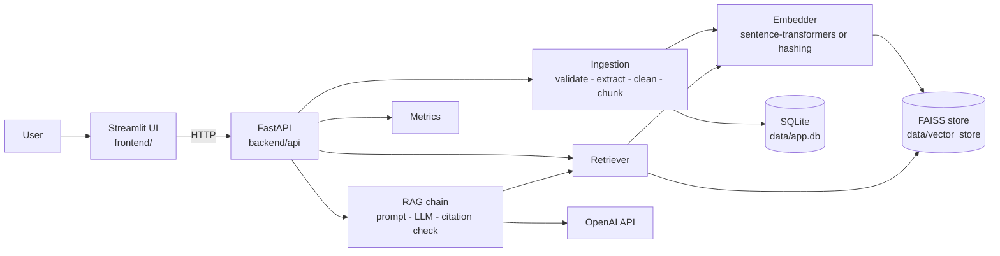

# Enterprise AI Knowledge Assistant

A RAG (Retrieval-Augmented Generation) system for asking natural-language questions about PDF documents and getting
answers **grounded in the documents, with source citations and page numbers**. FastAPI backend, Streamlit frontend,
FAISS vector search, SQLite metadata, automated tests and an evaluation harness.

> **Status:** working locally and covered by 71 automated tests. See [Verification status](#verification-status) for what
> has and has not been tested. Nothing here has been deployed to a cloud service.

## Problem statement

Organisations keep policies, manuals and reports in PDFs. Keyword search misses questions phrased differently from the
text, and a general-purpose LLM may answer confidently from memory instead of from the organisation's documents. This
project retrieves the most relevant passages first, instructs the model to answer only from them, verifies that every
citation maps to a passage that was actually retrieved, and says so explicitly when the documents do not contain the
answer.

## Features

- PDF upload with validation (type, size, signature, encryption, corruption); scanned PDFs are rejected with a clear
  message because **OCR is not implemented**.
- Page-aware, overlapping chunking (configurable); metadata kept: filename, document ID, page, chunk ID.
- Persistent FAISS index (survives restarts); duplicate detection by document text; add, list and delete documents.
- Semantic search (top-k, similarity threshold) and a **search-only mode** that needs no LLM key.
- RAG answers with `[S#]` citations validated against retrieved chunks; invented citations are removed; an explicit
  fallback when context is insufficient (the LLM is not even called when nothing is retrieved).
- Prompt-injection hardening: retrieved text is delimited, sanitised and declared untrusted in the system prompt.
  This reduces risk but is not a guarantee (see [docs/SECURITY.md](docs/SECURITY.md)).
- REST API with Pydantic validation, consistent error format, OpenAPI docs at `/docs`, optional token auth.
- Streamlit UI: chat with citations, expandable retrieved passages, search-only mode, document manager, monitoring page,
  evaluation page.
- In-process metrics (requests, failures, latency percentiles, ingestion time, tokens); query log stores hashes only.
- Evaluation harness: Recall@k and MRR (offline), plus optional end-to-end answer evaluation.

## Architecture



Details: [docs/ARCHITECTURE.md](docs/ARCHITECTURE.md).

## Technology stack

Python 3.11+ (developed on 3.12), FastAPI, Uvicorn, Pydantic / pydantic-settings, SQLAlchemy (SQLite; other databases via
`DATABASE_URL` are untested), PyPDF, FAISS (`faiss-cpu`), sentence-transformers, OpenAI SDK, Streamlit, httpx, pandas,
NumPy, pytest, Ruff, Docker, GitHub Actions.

LangChain is deliberately **not** used: chunking, prompting and citation checking are small and explicit here, and
fewer dependencies are easier to audit.

## Repository structure

```text
backend/
  api/                 main.py (app factory), routes.py, schemas.py, state.py
  document_loading/    validation.py, pdf_reader.py
  processing/          text_cleaner.py, chunking.py
  embeddings/          embedding_service.py   (sentence-transformers + offline hashing embedder)
  indexing/            vector_store.py        (persistent FAISS)
  retrieval/           retriever.py
  rag/                 chain.py, prompts.py, citations.py
  database/            models.py, repository.py
  monitoring/          metrics.py, logging_config.py
  evaluation/          evaluator.py, run_evaluation.py
  ingestion.py         ingestion service (validate -> index -> record)
  config.py            environment-based settings
frontend/              app.py (chat), common.py, pages/{1_Documents,2_Monitoring,3_Evaluation}.py
tests/                 unit/ and integration/ (API + Streamlit pages)
evaluation_data/       sample_questions.json
sample_documents/      northwind_policies.pdf (fictional) + README
scripts/               generate_sample_pdf.py, initialize_database.py
docs/                  ARCHITECTURE, API, DEVELOPMENT, EVALUATION, SECURITY, DEPLOYMENT
.github/               workflows/tests.yml, issue + PR templates
Dockerfile, docker-compose.yml, Makefile, requirements*.txt, pyproject.toml, .env.example
```

## Installation (Windows PowerShell)

Prerequisites: Python 3.11 or newer (3.12 recommended) and Git. Docker, PostgreSQL, CUDA and a paid API are **not**
required for the tests or for search-only use.

```powershell
git clone <your-repository-url>
cd enterprise-ai-knowledge-assistant

py -3.12 -m venv .venv
.\.venv\Scripts\Activate.ps1          # if blocked: Set-ExecutionPolicy -Scope Process -ExecutionPolicy Bypass
python -m pip install --upgrade pip
pip install -r requirements-dev.txt   # runtime + test/lint tools (installs PyTorch; large download)

Copy-Item .env.example .env
```

Lighter install for trying things offline (skips PyTorch): install everything except `sentence-transformers`, then set
`EMBEDDING_BACKEND=hashing` in `.env`. The hashing embedder is **lexical, not semantic**.

### Configuration

All settings are read from `.env` (see `.env.example`; every variable listed is used by the code).

| Variable | Default | Purpose |
|---|---|---|
| `OPENAI_API_KEY` | _(empty)_ | Needed only for `/chat`. Never commit it. |
| `LLM_PROVIDER` / `LLM_MODEL` | `openai` / `gpt-4o-mini` | Only `openai` is implemented. Check the model name is available to your account. |
| `EMBEDDING_BACKEND` | `sentence-transformers` | `sentence-transformers` or `hashing` |
| `EMBEDDING_MODEL` | `sentence-transformers/all-MiniLM-L6-v2` | Downloaded from Hugging Face on first use |
| `VECTOR_STORE_PATH` | `./data/vector_store` | Persistent FAISS index |
| `DATABASE_URL` | `sqlite:///./data/app.db` | SQLAlchemy URL |
| `CHUNK_SIZE` / `CHUNK_OVERLAP` | `800` / `120` | Characters; overlap must be smaller than size |
| `TOP_K` / `SIMILARITY_THRESHOLD` | `5` / `0.0` | Retrieval defaults |
| `MAX_UPLOAD_MB` | `10` | Upload size limit |
| `ADMIN_TOKEN` | _(empty)_ | If set, upload/delete/metrics require header `X-API-Token` |
| `LOG_LEVEL` | `INFO` | |
| `API_BASE_URL` | `http://127.0.0.1:8000` | Used by the Streamlit frontend only |

To enable answers, edit `.env` and set `OPENAI_API_KEY=` to your key, then restart the backend. Changing
`EMBEDDING_MODEL`/`EMBEDDING_BACKEND` after indexing changes the vector size: the backend then reports an index
mismatch and you must delete `data/vector_store` and re-upload.

## Run

Two terminals, both with the virtual environment active.

```powershell
# Terminal 1: backend  (API docs: http://127.0.0.1:8000/docs)
python -m uvicorn backend.api.main:create_app --factory --reload --port 8000

# Terminal 2: frontend  (http://localhost:8501)
python -m streamlit run frontend/app.py
```

### Try it with the sample PDF

In the UI: open **Documents**, upload `sample_documents/northwind_policies.pdf`, then ask on the main page
"How many paid vacation days do full-time employees receive?" (use *Search only* if no API key is configured).

Or from PowerShell:

```powershell
curl.exe -F "files=@sample_documents/northwind_policies.pdf" http://127.0.0.1:8000/documents/upload

Invoke-RestMethod -Method Post -Uri http://127.0.0.1:8000/search -ContentType "application/json" `
  -Body '{"query":"How many vacation days?","top_k":3}'

Invoke-RestMethod -Method Post -Uri http://127.0.0.1:8000/chat -ContentType "application/json" `
  -Body '{"query":"How many vacation days do full-time employees get?"}'
```

If `ADMIN_TOKEN` is set, add `-H "X-API-Token: <token>"` to `curl.exe` or `-Headers @{"X-API-Token"="<token>"}`.
Endpoint reference and real example responses: [docs/API.md](docs/API.md).

## Tests

```powershell
python -m pytest                              # 71 tests; no API key, network or model download needed
python -m pytest --cov=backend --cov-report=term-missing
ruff check .
```

Tests use a deterministic hashing embedder and a scripted fake LLM. The integration tests drive the real FastAPI app
over HTTP and the real Streamlit pages headlessly.

## Evaluation

```powershell
python -m backend.evaluation.run_evaluation                      # offline retrieval metrics, configured embedder
python -m backend.evaluation.run_evaluation --embedder hashing   # no model download (lexical, not semantic)
python -m backend.evaluation.run_evaluation --generate --judge   # end-to-end; needs OPENAI_API_KEY
```

Results are written to `data/evaluation_results.json` and shown on the Evaluation page. The run uses a temporary
index and does not touch your real one. Methodology, metrics and limitations: [docs/EVALUATION.md](docs/EVALUATION.md).

Measured in the development environment with the **hashing (non-semantic) embedder** on the 15-question fictional
dataset: Recall@1 0.933, Recall@3 1.000, Recall@5 1.000, MRR 0.967. The index holds only 6 chunks (one per page), so
these figures show the harness works, not production retrieval quality. Semantic-embedder and end-to-end results have
**not** been measured yet.

## Monitoring

`GET /metrics` and the Monitoring page show request counts, failures, latency percentiles (response, retrieval, LLM,
ingestion), ingestion failures, token counts reported by the provider, and index size. Metrics live in memory and reset
on restart. Question text and document text are never logged; the query log stores a SHA-256 and length only.

## Docker

```powershell
Copy-Item .env.example .env       # then add OPENAI_API_KEY if you want /chat
docker compose up --build
```

Backend: http://localhost:8000/docs, frontend: http://localhost:8501. The `app_data` volume holds the FAISS index,
SQLite database and the Hugging Face model cache. **The Dockerfile and compose file have not been built or run** (Docker
was unavailable where this was developed); treat them as untested. More in [docs/DEPLOYMENT.md](docs/DEPLOYMENT.md).

## Security notes

Secrets come from the environment only; uploads are validated; error messages are generic; documents are treated as
untrusted; optional token auth protects upload/delete/metrics. There is **no multi-user separation or login**, and with
`ADMIN_TOKEN` unset those endpoints are open (the backend logs a warning). Do not expose it to the internet as-is. See
[docs/SECURITY.md](docs/SECURITY.md) for what is implemented versus what a real enterprise deployment would add.

## Verification status

| Area | Status |
|---|---|
| 71 unit + integration tests, Ruff lint/format | Passed on Python 3.12.3, Linux |
| FastAPI start via uvicorn factory, upload/search/delete over real HTTP | Verified |
| Streamlit start (headless) and all 4 pages against live backends | Verified |
| Sample PDF generation (deterministic) and offline evaluation | Verified (hashing embedder) |
| `docker-compose.yml`, workflow YAML, `make -n` targets | Parsed/dry-run only |
| Live OpenAI call (`OpenAIClient`) | **Not tested** (no key/network); only the missing-key path and a fake LLM |
| `sentence-transformers` install, model download, semantic retrieval quality | **Not tested** (Hugging Face unreachable in dev environment) |
| Docker build/run, GitHub Actions run, Python 3.11, native Windows run | **Not tested** |
| PostgreSQL, cloud deployment, concurrent load | **Not tested** |

## Known limitations

- No OCR: scanned PDFs are rejected. Tables and complex layouts depend on PyPDF's text extraction.
- Character-based chunking; no reranker; exact (flat) FAISS search, fine for thousands of chunks, not millions.
- Single-tenant; no user accounts. Metrics are in-memory.
- OpenAI is the only LLM provider implemented.
- Prompt-injection defences are mitigations, not guarantees.
- Evaluation dataset is tiny and fictional.

## Future improvements

OCR for scanned PDFs, cross-encoder reranking, hybrid (BM25 + vector) search, multi-user auth with per-user indexes,
persistent metrics, streaming answers, a local-LLM provider, larger labelled evaluation sets, PostgreSQL migrations.

## License

MIT. Replace the copyright placeholder in [LICENSE](LICENSE) before publishing.
